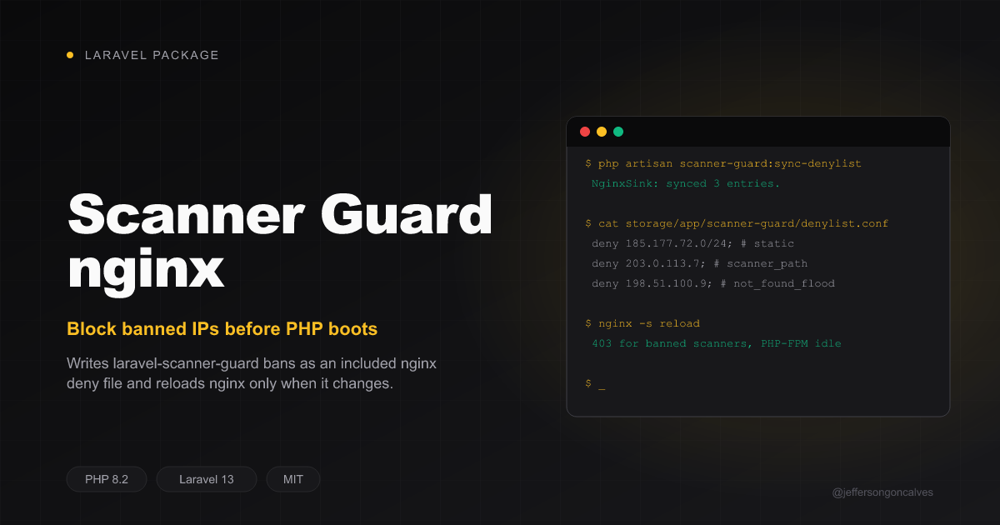

<div class="filament-hidden">



</div>

# Laravel Scanner Guard nginx

[](https://packagist.org/packages/jeffersongoncalves/laravel-scanner-guard-nginx)
[](https://github.com/jeffersongoncalves/laravel-scanner-guard-nginx/actions/workflows/tests.yml)
[](https://packagist.org/packages/jeffersongoncalves/laravel-scanner-guard-nginx)

nginx denylist sink for [`laravel-scanner-guard`](https://github.com/jeffersongoncalves/laravel-scanner-guard).
Writes every banned IP and `ip_blocklist` entry as an nginx `deny` line, so banned scanners are
rejected by nginx before PHP-FPM boots.

```nginx
deny 185.177.72.0/24; # static
deny 203.0.113.7; # scanner_path, expires 2026-11-20T10:00:00+00:00
```

## Installation

```bash
composer require jeffersongoncalves/laravel-scanner-guard-nginx
```

Add the sink to `config/scanner-guard.php`:

```php
'sinks' => [
    \JeffersonGoncalves\ScannerGuardNginx\NginxSink::class,
],
```

`include` the file from your nginx server block:

```nginx
server {
    include /var/www/html/storage/app/scanner-guard/denylist.conf;
    # ...
}
```

`scanner-guard:sync-denylist` now runs every minute, and right after every ban, unban and blocklist
change (see the core README's "Blocking before PHP" section).

## Configuration

```bash
php artisan vendor:publish --tag="laravel-scanner-guard-nginx-config"
```

| Key | Env | Default | |
|---|---|---|---|
| `path` | `SCANNER_GUARD_NGINX_PATH` | `storage/app/scanner-guard/denylist.conf` | relative to `base_path()` |
| `reload_command` | `SCANNER_GUARD_NGINX_RELOAD_COMMAND` | `null` | e.g. `sudo nginx -s reload` |

The file is only rewritten when its content changes, through a temp file renamed over the target,
so nginx never reads a half-written list. nginx only re-reads an `include`d file on reload: the
`reload_command` runs after a write, never otherwise. A non-zero exit or a timeout is logged, never
thrown. The PHP user (and your queue worker, if different) must be allowed to run it without a
password, e.g. in `/etc/sudoers.d/scanner-guard`:

```
www-data ALL=NOPASSWD: /usr/sbin/nginx -s reload
```

In a container where PHP can't signal nginx, set the command to `exit 0` and let a root process
reload nginx when the file's mtime changes.

### Behind a proxy or CDN

`deny` matches `$remote_addr`. Behind Cloudflare or a load balancer, that is the proxy's IP unless
you restore the client IP first with `set_real_ip_from` + `real_ip_header` (`CF-Connecting-IP` for
Cloudflare), trusting only the proxy's ranges. Otherwise the denylist never matches a visitor.

## Upgrading from laravel-scanner-guard 1.x

This package is what `sync_to_nginx` became in 2.0. Same file, same lines, same env vars. See the
core [UPGRADE.md](https://github.com/jeffersongoncalves/laravel-scanner-guard/blob/main/UPGRADE.md).

## Testing

```bash
composer test
```

## Changelog

Please see [CHANGELOG](CHANGELOG.md) for more information on what has changed recently.

## Credits

- [Jefferson Gonçalves](https://github.com/jeffersongoncalves)
- [All Contributors](../../contributors)

## License

The MIT License (MIT). Please see [License File](LICENSE.md) for more information.
